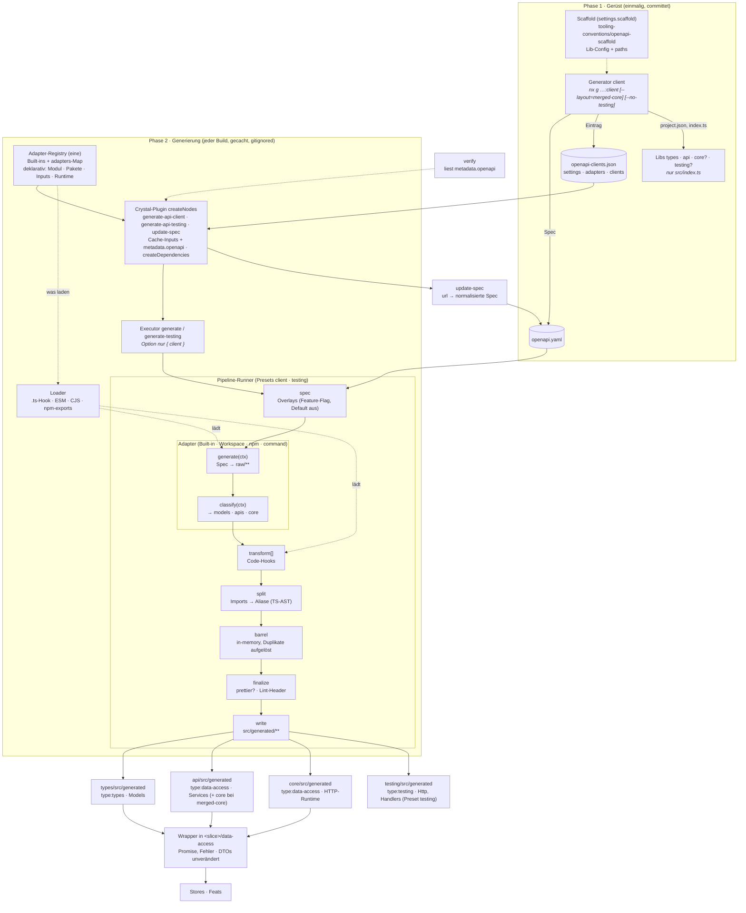

# OpenAPI-Clients

HTTP-Clients werden aus OpenAPI-Specs generiert. Der Code-Generator ist austauschbar (eingebaute Adapter oder eigene des Consumers) und steckt hinter einer Facade in `packages/tooling/openapi` (publishable, siehe [Pipeline-Architektur](openapi-pipeline-architektur.md)). Die Facade legt fest, wo der Code liegt, und teilt ihn in Nx-Libs auf. Generierter Code wird **nicht committet**: pro Lib ist nur `src/index.ts` (`export * from './generated';`) im Repo, alles unter `src/generated/` ist gitignored und entsteht per `generate-api-client` (Client) bzw. `generate-api-testing` (Testing-Lib). Grundlage: Spike S1 (Facade, Branch `tmp/openapi-spike`), S2 (nx-plugin-openapi), S3 (MSW-Testing).

## Architektur

Bausteine als Black Box. Zwei Phasen: **Gerüst** (Generator `client`, einmalig, committet) und **Generierung**
(Targets `generate-api-client` / `generate-api-testing`, bei jedem Build, gecacht, gitignored). Die Facade entscheidet *wo* Code liegt,
der Adapter liefert nur Roh-Output + Klassifizierung. Ein Runner mit festen Stages für beide Presets. Entscheidungen, Trade-offs,
vorher/nachher: [`docs/openapi-pipeline-architektur.md`](openapi-pipeline-architektur.md).



Detail (Dateien und Datenfluss):

```
openapi-clients.json (Root)            settings?, adapters?, clients: { <pfad>: url?, adapter?, options?, layout?, pipeline? }
libs/[<domain>/]generated/<client>/
  openapi.yaml | openapi.json          committet, einzige Quelle der Generierung (die url dient nur update-spec)
        │
        ▼  <client>:generate-api-client = @mo-transfer/tooling-openapi:generate   (Preset client)
        ▼  <client>-testing:generate-api-testing = …:generate-testing             (Preset testing)
 runner.ts  spec (Overlays*) → generate (Adapter via Registry + Loader → tmp/openapi/<pfad>/raw/**) → classify
            → transform[] → split (relative Imports über Teilgrenzen → @mo-transfer/<pfad>/<teil>)
            → barrel (index.ts je Teil, in-memory) → finalize (prettier?, Header) → write
        ▼
  types/src/generated/**   type:types        Models
  api/src/generated/**     type:data-access  Services (+ Runtime bei layout merged-core)
  core/src/generated/**    type:data-access  Runtime (Configuration, BASE_PATH, provideApi …, importiert HTTP)
  testing/src/generated/** type:testing      openapi-typescript + openapi-msw (+ handlers.ts bei mocks: examples; außer pipeline.testing: false)
        ▼
 Wrapper in <slice>/data-access bzw. shared/data-access ── Promise statt Observable, Fehler mit Status, DTOs unverändert ──▶ Stores, Feats, ui
```

`*` experimentell: nur mit `settings.features.overlays: true`.

| Datei | Aufgabe |
|---|---|
| `packages/tooling/openapi/src/adapter.ts` | SPI v1 (Export `./adapter`): `defineAdapter`, `defineTransform`, `defineScaffold`, `ClientDefinition`, `AdapterContext`, `Classification` |
| `…/openapi/src/settings.ts`, `config.ts` | Settings mit Defaults (`libsDir`, `aliasPrefix`, `outputDir`, Header, Scaffold, Feature-Flags …), `openapi-clients.json` lesen, Layout/Parts |
| `…/openapi/src/registry/*` | eine Registry (Built-ins + `adapters`), Modul-Referenzen + Cache-Inputs, Loader (`.ts`/ESM/CJS/npm), Validierung (apiVersion, id, `optionsSchema`, `requires`) |
| `…/openapi/src/pipeline/*` | Runner + Stages (spec/Overlay/JSONPath, split, barrel, transform), Presets `client-preset.ts` / `testing-preset.ts` |
| `…/openapi/src/adapters/*` | `openapi-tools`, `hey-api`, `nx-plugin-openapi`, `command` |
| `…/openapi/src/facade.ts`, `executors/*` | `resolveClient`, `generateClient`, `generateTesting`, `updateSpec`; Executoren mit Fehlerausgabe (Phase, Hint, Ursachen) und `--verbose` |
| `…/openapi/src/project-config.ts`, `plugin/openapi-clients.ts` | inferierte Targets + Inputs + `metadata.openapi`, `createNodes`/`createDependencies`, Client-/Teil-`project.json` |
| `…/generators/client`, `…/openapi/src/clients.ts` | Generator `client` (Scaffold-SPI), Pflege von `openapi-clients.json` und Client-`project.json` in `move`/`rename`/`remove` |
| `…/conventions/src/openapi-scaffold.ts` | Lib-Config der Teil-Libs nach Blueprint-Konvention (`settings.scaffold`) |
| `openapitools.json` | Jar-Version 7.25.0, `storageDir: ./node_modules/.cache/openapi-generator-cli` |

## Ablage, Projekte, Tags

```
libs/generated/<client>/                   scope:shared    Client-Projekt generated-<client> (project.json: nur Targets, kein Code, kein Alias)
libs/<domain>/generated/<client>/          scope:<domain>  Client-Projekt <domain>-generated-<client> (project.json)
  openapi.yaml|json                        committet
  types/src/index.ts     → Lib …-types     scope:<s> type:types   feat:none generated
  api/src/index.ts       → Lib …-api       scope:<s> type:data-access feat:none generated
  core/src/index.ts      → Lib …-core      scope:<s> type:data-access feat:none generated
  testing/src/index.ts   → Lib …-testing   scope:<s> type:testing feat:none generated   (kein build)
  <teil>/src/generated/**                  gitignored (.gitignore: **/src/generated/**)
```

- **`generated` ist ein reservierter Ordner**, kein Scope und kein Layer. `libs/generated/…` gehört zu `shared`, die Scope-Liste bleibt unverändert. `domain generated` wird abgelehnt, einen falschen Pfad (`libs/generated/x/ui`) lehnen Generatoren ab und `verify` meldet ihn (Tags passen zu keinem Teil).
- **Domain-Client ist slice-privat:** `booking/generated/**` sieht nur booking. Fremde Domains kommen nie heran (keine Ports).
- **`api` und `core` sind `type:data-access`**, weil HTTP Aufgabe von `data-access` ist (die Runtime importiert `@angular/common/http`, in `utils`/`state`/`ui`/`feature` verboten). Die Ordnernamen `api`/`core` bleiben, `api` ist kein Layer.
- `type:types` → `type:types` gilt (Domain-Types dürfen generierte Models nutzen). `data-access`/`state`/`feature` dürfen generierte Services laut Matrix direkt nutzen, Konvention bleibt „über den Wrapper in `data-access`“.
- **Wrapper:** `BookingApi`, `BookingNotifications` (`booking/data-access`), `CheckinApi`, `CheckinNotifications` (`checkin/data-access`), `PetApi` (`shared/data-access`).
- Config-Wächter: im Client-Ordner liegen nur `project.json` und die Spec; `openapi.(yaml|json)` an jeder anderen Stelle in `libs/` meldet `tooling-verify:verify` als Config-Datei außerhalb einer Lib.

## `openapi-clients.json`

```json
{
  "$schema": "./packages/tooling/openapi/openapi-clients.schema.json",
  "defaultAdapter": "openapi-tools",
  "settings": { "scaffold": "@mo-transfer/tooling-conventions/openapi-scaffold", "testing": { "mocks": "examples" } },
  "clients": {
    "generated/pet-client": { "url": "https://petstore3.swagger.io/api/v3/openapi.json", "adapter": "hey-api" },
    "generated/notification-client": {},
    "booking/generated/booking-client": {},
    "checkin/generated/checkin-client": {}
  }
}
```

| Feld | Bedeutung |
|---|---|
| Schlüssel | Client-Pfad unter `libs/` |
| `adapter` | `openapi-tools` (Default), `hey-api`, `nx-plugin-openapi`, `command` oder ein Schlüssel aus `adapters` |
| `url` | nur für `update-spec` |
| `options` | Adapter-Optionen, über die Adapter-Defaults gemergt (z.B. `{ "plugin": "hey-api" }` für nx-plugin-openapi), gegen das `optionsSchema` des Adapters geprüft |
| `layout` | `merged-core`: core in der api-Lib (keine core-Lib). Default types/api/core |
| `pipeline` | `overlays` (experimentell, Flag `settings.features.overlays`), `transforms` (Code-Hooks), `format` (prettier), `testing` (`msw` \| `false`) |
| `adapters` (Datei-Ebene) | eigene Adapter: `module` (Workspace-Pfad, npm-Paket, `builtin:<id>`), `packages`, `inputs`, `runtime`, `options` |
| `settings` (Datei-Ebene) | Workspace-Annahmen mit Defaults (`libsDir`, `clientFolder`, `outputDir`, `aliasPrefix`, `sharedScope`, `specFiles`, `scaffold`, `features`, `testing`); hier `scaffold` und `testing.mocks: examples` (Opt-in, Library-Default `none`) gesetzt. `scaffold` ist ein Paket: `@mo-transfer/tooling-conventions` steht deshalb in der Root-`package.json` (`workspace:*`), sonst scheitert `nx g …:client` mit „package … not installed“ |

Die Datei liest zur Laufzeit die Executoren (`resolveClient`), bei jeder Graph-Berechnung das Plugin, beim Anlegen der Generator und `tooling-verify:verify`. Die `project.json` des Clients und seiner Teile schreibt der Generator `client` (Vorlage `packages/tooling/openapi/src/project-config.ts`): Client-Projekt mit Name + Tags (`generate-api-client` + `update-spec` inferiert das Plugin), Teil-Libs mit `implicitDependencies` und die Testing-Lib mit eigenem `generate-api-testing` (`lint`/`typecheck` mit `dependsOn: ['generate-api-testing', '^generate-api-client', '^generate-api-testing']`). Eintrag, Ordner und Spec müssen zusammenpassen: `tooling-verify:verify` prüft Eintrag ↔ Ordner ↔ eine Spec ↔ vier Libs, bekannter Adapter, keine expliziten Client-Targets, Kanten und dass die vier `index.ts` genau `export * from './generated';` enthalten.

**Warum eine eigene Datei statt `nx.json`:** Jede Änderung an `nx.json` invalidiert den ganzen Cache (Spike S1, belegt).

**Warum der Eintrag in der eigenen Datei bleibt und keine Target-Option wird** (auch in der expliziten Variante): Nx hasht in `^default`/`^production` die `ProjectConfiguration` jeder Abhängigkeit mit (Hash-Plan von `shared-data-access:typecheck` enthält `generated-pet-client:ProjectConfiguration`). Stünde der Eintrag in den `options` von `generate-api-client`, liefe nach jeder Eintragsänderung alles neu, was vom Client abhängt, auch wenn der generierte Code gleich bleibt. Deshalb:

- Target-Optionen sind nur `{ "client": "<pfad>" }`, die Executoren lesen den Eintrag zur Laufzeit (`resolveClient`).
- Der Eintrag ist ein **`json`-Input** von `generate-api-client`: `{ "json": "{workspaceRoot}/openapi-clients.json", "fields": ["defaultAdapter", "settings", "adapters.<id>"?, "clients.<pfad>"] }` (`generate-api-testing`: `settings`, `clients.<pfad>.pipeline`).
- `update-spec` gibt es für jeden Client (ohne `url` bricht es ab), damit eine neue `url` die Projekt-Config nicht ändert.
- Ein Adapterwechsel ändert die Inputs (`externalDependencies` des Adapters) und damit die Projekt-Config: nur `openapi-clients.json` anpassen, das Plugin leitet die Inputs ab. Die Abhängigen laufen dann neu, was sie wegen des neuen Codes ohnehin müssten.
- Alternativ Adapter + Optionen in die Target-Optionen: sichtbarer, aber jede Optionsänderung invalidiert alle Abhängigen (Cache-Befund oben), und Facade, Tests und Generator lesen die Datei. Deshalb verworfen.

**Cache-Probe** (eigener Cache, `run-many -t build lint test typecheck generate` — damaliger Target-Name, heute `generate-api-client generate-api-testing` —, 155 Tasks, Ausgangslage 153/155 aus dem Cache; die 2 übrigen sind `sheriff-blueprint:build/test` ohne Cache; gemessen in sheriff-blue-print, das Paket ist hier nicht übernommen):

| Änderung | neu gelaufen |
|---|---|
| pet-client: `"options": { "providedIn": "root" }` (= Default, gleicher Code) | nur `generated-pet-client:generate` (152/155) |
| notification-client: `url` ergänzt | nur `generated-notification-client:generate` (152/155) |
| pet-client: `"options": { "enumPropertyNaming": "original" }` (anderer Code) | pet-client (generate, Teile, testing), `shared-api` und dessen Abhängige (`checkin-api`, `checkin-data`, `checkin-feat-*`, `checkin-shell`); booking, notification, layout, auth aus dem Cache (116/155). *Messung auf explicit-config, Lib-Namen von dort* |
| booking-client-Spec: `description` am Schema | booking-client, booking-Libs, `checkin-feat-*`, `checkin-shell`, `client:build` (106/155) |
| zurück | 153/155 |

Vor dem Umbau auf den `json`-Input liefen im ersten Fall 41 Tasks neu (Messung explicit-config: `shared-api`, `checkin-*`, `client:build` …), obwohl der generierte Code byte-gleich war.

## Targets und Abhängigkeiten

| Projekt | Target | Konfiguration |
|---|---|---|
| Client (Plugin) | `generate-api-client` | `@mo-transfer/tooling-openapi:generate`, gecacht. Inputs: Spec, Overlays (nur mit Flag), Eintrag (`json`-Input), `index.ts` der Code-Teile, Tooling-Quellen (Pipeline, Registry, Executoren, Plugin, Adapter; als npm-Paket: `externalDependencies`), Adapter-Inputs aus der Registry (Modul-Ordner bzw. Paket, `packages`, `inputs`, `runtime`; Java-Adapter: `openapitools.json`, `java -version 2>&1`), Transform-Module, prettier bei `format`. Outputs: `{types,api,core?}/src/generated` |
| Client (Plugin) | `update-spec` | `@mo-transfer/tooling-openapi:update-spec`, nicht gecacht: lädt die `url`, schreibt YAML/JSON normalisiert (danach Prettier wie `formatFiles`) |
| `…/testing` (Plugin) | `generate-api-testing` | `@mo-transfer/tooling-openapi:generate-testing`, gecacht, nur ohne `pipeline.testing: false`. Inputs: Spec, Overlays (Flag), `settings` + `clients.<pfad>.pipeline`, Pipeline-Quellen, Transforms, `openapi-typescript`, `yaml` (+ `pipeline/examples/**` bei `examples`). Output `src/generated`. `lint`/`typecheck` hängen (explizit in der `project.json`) zusätzlich an `generate-api-testing` |
| jede Lib (`targetDefaults`) | `lint`, `typecheck`, `build`, `test` | `dependsOn: ['^generate-api-client', '^generate-api-testing']` (build: zusätzlich `^build`), Input `{ dependentTasksOutputFiles: '**/src/generated/**/*.ts', transitive: true }` |
| Teil-Lib (`project.json`) | `implicitDependencies` | Client-Projekt; `api` → `core`, `types` (merged-core: nur `types`); `core` → `types` |
| `client:build` | Input (`targetDefaults`) | ebenfalls `dependentTasksOutputFiles` (die App bündelt die Libs aus `dist`) |

- **Gitignored = für Nx unsichtbar.** Nx hasht keine gitignored Dateien und analysiert ihre Imports nicht. Deshalb der `dependentTasksOutputFiles`-Input (sonst kämen Konsumenten nach einer Spec-Änderung aus einem veralteten Cache) und die impliziten Kanten (sonst kein `affected` und keine Build-Reihenfolge). Beleg: Property `guestName` in der booking-Spec umbenannt → `booking-api:typecheck` rot (damals; heute `booking-data-access`); `description` ergänzt → auch `client:build` läuft neu (vor dem Fix blieb es im Cache).
- **Zwei Target-Namen** (`generate-api-client` am Client-Projekt, `generate-api-testing` an der Testing-Lib, Konstanten `CLIENT_GENERATE_TARGET`/`TESTING_GENERATE_TARGET` in `project-config.ts`): jeder Name sagt, welcher Code entsteht; `dependsOn` nennt beide explizit statt eines gemeinsamen Namens für zwei verschiedene Pipelines. Beide schreiben nach `src/generated`, der `dependentTasksOutputFiles`-Input hasht also beide. Die Executor-Namen bleiben `generate`/`generate-testing`.
- `^generate-api-client`/`^generate-api-testing` reichen über den ganzen Graph: `nx run booking-data-access:typecheck` generiert vorher den booking-client. Specs, die eine Testing-Lib importieren, sind Graph-Kanten, `^generate-api-testing` erzeugt also auch die Testing-Libs.
- **`nx affected`**: Spec-Änderung → Client, Teile, Wrapper in `data-access`, Konsumenten, App (per impliziter Kante). Eine Änderung an `openapi-clients.json` gehört keinem Projekt; sie ist Input von `update-spec` (nicht gecacht, also nur für `affected`) → alle Clients + Abhängige. Der Cache von `generate-api-client` bleibt pro Eintrag.
- **IDE:** `pnpm openapi:generate` (= `nx run-many -t generate-api-client generate-api-testing`) nach dem Checkout, sonst meldet die IDE `Cannot find module './generated'`. Kein `postinstall`: `pnpm install` bräuchte dann Java und Netz. Build, Lint, Typecheck und Test generieren selbst.
- Deterministisch: zweimal `generate-api-client --skip-nx-cache` ergibt byte-gleiche Dateien, die dist der Client-Libs steht im Snapshot von `verify:nx-internals`.

## Inferierte Client-Targets (Plugin)

`generate-api-client` und `update-spec` des Client-Projekts und `generate-api-testing` der Testing-Lib stehen nicht in den `project.json` (Client: nur Name + Tags), sondern kommen von `@mo-transfer/tooling-openapi/plugin` (`createNodes`, Nx 23, auf `openapi-clients.json`, in `nx.json` → `plugins`; Optionen `clientTargetName`/`testingTargetName`/`updateSpecTargetName`). Explizit bleiben Teil-Libs, Kanten und `lint`/`typecheck`-`dependsOn` der Testing-Lib. Das Plugin hängt `metadata.openapi` (Adapter, Herkunft, Layout, Parts, Problem, deaktivierte Features) an das Client-Projekt — `verify` liest daraus statt die Registry nachzubauen — und meldet per `createDependencies` Kanten Client → `npm:<paket>` eigener Adapter/Transforms. `nx show project generated-pet-client` zeigt die Targets.

**Warum vorher explizit:** Die Variante explizite Config hat alle Crystal-Plugins entfernt (Graph ohne eigenen Code, Tippfehler bricht den Graphen nicht, Plugins nicht mehr `lint`-Input aller Libs). Der OpenAPI-Teil war davon nur mitbetroffen: das Argument „Target-Optionen gehen in den Hash aller Abhängigen“ betrifft *wo der Eintrag steht* (Datei + `json`-Input statt Optionen), nicht *wer das Target schreibt*.

**Bewertung:**

| Punkt | Befund |
|---|---|
| Machbar | ja: Targets sind vollständig aus Eintrag + Adapter-Registry + Spec-Datei ableitbar (genau das tat der Generator und prüfte `verify`). Plugin nutzt `inferClientTargets` aus `project-config.ts` |
| Hash / Cache | Nx hasht die *gemergte* `ProjectConfiguration` (`project.json` + Plugin). Optionen bleiben `{ client }`, der Eintrag bleibt `json`-Input. Gemessen: `url` am notification-Eintrag → nur `generated-notification-client:generate` (heute `generate-api-client`) neu (138/139 aus dem Cache), Abhängige aus dem Cache. Einmalig beim Umstieg laufen die Abhängigen der Clients neu (`^default` enthält die geänderte Client-`project.json`), danach stabil |
| Adapter-Inputs | aus dem Eintrag abgeleitet: Adapterwechsel = eine Datei, kein Drift mehr möglich (der `verify`-Abgleich Inputs ↔ Adapter entfällt) |
| Plugin-Cache | das Plugin rechnet bei jeder Graph-Berechnung neu (zwei JSON-Dateien + `existsSync` je Client, kein eigener Cache nötig). Nx re-evaluiert es bei Dateiänderungen; nach Änderungen am Plugin-Code ggf. `nx reset` (Daemon) |
| `nx affected` | unverändert: Nx liest Target-Inputs aus dem gemergten Graphen (`getImplicitlyTouchedProjects`), `openapi-clients.json` → alle Clients (über `update-spec`), Spec → Client + Abhängige. Eine geänderte `openapi-clients.json` passt auf das Plugin-Glob, markiert aber nur beim *Löschen* alle Projekte. Neu: Plugin + `project-config.ts` sind `generate-api-client`-Inputs, damit eine Änderung daran per `affected` die Clients erreicht (Probe in `verify`) |
| Robustheit | ein kaputter Eintrag (unbekannter/fehlerhafter Adapter, `null`-Einträge, falsche Abschnitts-Typen, Transforms ohne `module`, keine/zwei Specs, ungültige Settings) oder eine unlesbare Datei bricht den Graphen nicht: Warnung, kein `generate-api-client`, Problem in `metadata.openapi`, `verify` meldet — getestet im Nx-Fixture (`test/integration/robustness.spec.ts`, 10 Formen). Ohne Client-`project.json` kein Knoten (kein namenloses Projekt) |
| Generator / move / rename / remove | `client` schreibt nur Name + Tags; `move`/`rename` ziehen Eintrag + Name/Tags nach, die Targets folgen dem Eintrag automatisch (`relocateClientProject` muss keine Pfade in Targets mehr umschreiben); `remove` unverändert |
| `verify` | prüft weiter am Graphen (inferierte Targets: Optionen, `json`-Input, Spec-Input, Cache, Outputs, `update-spec`), neu: Plugin in `nx.json`, keine expliziten `generate-api-client`/`update-spec` in der Client-`project.json`, bekannter Adapter |

**Trade-offs:** Targets nicht mehr in der Datei sichtbar (nur per `nx show project`/Nx Console); eigener Code läuft wieder bei jeder Graph-Berechnung (klein, nur Lesezugriffe); ein lokales Plugin mehr in `nx.json`. Dafür: eine Quelle (`openapi-clients.json`) statt zwei, ~40 Zeilen weniger pro Client-`project.json`, Adapterwechsel ohne Zweitänderung, weniger Generator- und `verify`-Logik.

**Entscheidung:** Netto-Verbesserung, umgesetzt — die Client-Targets sind reine Ableitung aus `openapi-clients.json`, explizit geschrieben brauchten sie Generator + `verify` als Drift-Schutz. Teil-Libs und `generate-api-testing` bleiben explizit (Lib-Konvention, eigener Config-Satz pro Lib).

## Generator `client`

```sh
nx g @mo-transfer/tooling-openapi:client <name> [--domain=<d>] --spec=<datei|url> [--url=<url>] [--adapter=<id>] [--layout=merged-core] [--no-testing]
```

- legt `libs/[<d>/]generated/<name>/` an: Spec (Datei unverändert als `openapi.yaml|json`; URL einmal geladen und wie `update-spec` normalisiert), `src/index.ts` je Teil (`core` fehlt bei `--layout=merged-core`, `testing` bei `--no-testing`), `project.json` des Clients, Config-Dateien der Teil-Libs über das Scaffold (`settings.scaffold`, hier Blueprint-Konvention; Testing ohne Build-Dateien), `paths`-Einträge, Eintrag in `openapi-clients.json` (`url` = `--url` oder die Spec-URL; `adapter` nur, wenn er vom `defaultAdapter` abweicht; `layout`, `pipeline.testing`)
- prüft: kebab-case, Domain existiert (Scaffold), Client neu, OpenAPI 3.x mit mindestens einem Pfad, Adapter bekannt (Built-in oder `adapters`)
- `move`/`rename`: Eintrag wird mitgezogen (auch beim Verschieben einer ganzen Domain), Aliase umgeschrieben, `project.json` von Client und Teilen nachgezogen (Name, Scope-Tag, Spec-Input, `json`-Feld, Option `client`, `implicitDependencies`), `paths` umbenannt, bei `rename` auch die generierten Testing-Namen (`demoClientHttp` → `thingClientHttp`). `remove`: Eintrag, `paths` und Kanten raus, bricht ab, solange Code den Client importiert. Ein `remove` direkt nach `client` stellt den Ausgangszustand exakt wieder her (Spec im Tooling-Test, E2E: `git status` leer)
- `component`/`service`/`store` lehnen generierte Libs ab

## Adapter

| | openapi-tools (Default) | hey-api | nx-plugin-openapi |
|---|---|---|---|
| Paket | `@openapitools/openapi-generator-cli` 2.41.0 + Jar 7.25.0 | `@hey-api/openapi-ts` **0.83.1** (gepinnt) | `@nx-plugin-openapi/core`, `plugin-openapi`, `plugin-hey-api` 1.0.0, Backend über `options.plugin` |
| Java | ja (JRE 11+, CI: Temurin 17). Jar-Download beim ersten `generate-api-client` nach `node_modules/.cache/openapi-generator-cli` | nein | je nach Backend |
| Ausgabe → Teile | `model/*` → types, `api/*` → api, Root-Dateien → core; verworfen `index.ts`, `api.module.ts` | `types.gen.ts` → types, `sdk.gen.ts` + `@angular/**` → api, `client.gen.ts`, `client/**`, `core/**` → core | wie das Backend |
| Service-API | `BookingsService.listBookings(): Observable<Booking[]>`, `providedIn: 'root'`, `provideApi()` | `listBookings({ httpClient }): Promise<{ data, error, response }>` | wie das Backend |
| Models | `interface` + `namespace` (Enums als `const … as const`) | `type` mit Literal-Unions | wie das Backend |

**Tausch-Beweis** (historisch, damals noch mit Mapping im Wrapper; heute nutzen alle Layer die generierten DTOs direkt, ein Tausch trifft also jede Stelle, an der sich Name oder Form der Typen ändern, z.B. `Booking.StatusEnum` (openapi-tools) vs. Literal-Union (hey-api)) am booking-client (Eintrag in `openapi-clients.json` + Wrapper `booking/data-access/src/booking-api.ts`, gemessen auf `feat/nx-blueprint` (extern), `run-many -t build lint test typecheck`, 50 Projekte):

| Eintrag | Dateien types/api/core | Wrapper | Ergebnis |
|---|---|---|---|
| `{}` (openapi-tools) | 3/2/7 | Variante A | grün |
| `{ "adapter": "hey-api" }` | 1/3/12 | Variante B | grün |
| `{ "adapter": "nx-plugin-openapi", "options": { "plugin": "hey-api" } }` | 1/3/12 | Variante B | grün |
| `{ "adapter": "nx-plugin-openapi" }` (Backend openapi-tools) | 3/2/7 | Variante A | grün |

`git status` zeigte jeweils nur `openapi-clients.json` und den Wrapper `booking-api.ts` (damals in `booking/api`, hier `booking/data-access`; hier kommen die Adapter-Inputs in `libs/booking/generated/booking-client/project.json` dazu). Alle Konsumenten (Stores, feature, checkin, Tests, MSW-Handler) blieben unverändert:

```ts
// A (openapi-tools): Observable + HttpErrorResponse
private readonly bookings = inject(BookingsService);
return firstValueFrom(this.bookings.listBookings(), { defaultValue: [] });

// B (hey-api): Promise + Fehler als Wert
private readonly http = inject(HttpClient);
const { data, response } = await listBookings({ httpClient: this.http });
if (!response) return []; // abgebrochen
if (!response.ok) throw new Error(`GET /api/bookings failed: ${response.status}`);
return data ?? [];
```

Stand des Versuchs: `BookingApi` gab damals ein Promise zurück. Heute liefert sie ein Observable (`BookingStore` lädt per `rxResource`); Variante A entfällt dann `firstValueFrom`, Variante B braucht `from(...)`.

Die Testing-Lib hängt nicht am Adapter (nur an der Spec), ein Tausch lässt sie im Cache.

**Eigener Adapter (Consumer)**, ohne das Paket anzufassen: Modul mit `defineAdapter({ apiVersion: 1, id, defaults, optionsSchema?, requires?, generate, classify })` (`@mo-transfer/tooling-openapi/adapter`) im Workspace (`.ts`/`.js`/`.mjs`) oder als npm-Paket (auch ESM-only), Eintrag `adapters.<id>` in `openapi-clients.json` mit `module` + deklarativen Cache-Metadaten (`packages`, `inputs`, `runtime`, `options`). Das Plugin lädt keinen Adapter-Code; Cache-Input ist der Modul-Ordner bzw. das Paket (+ Graph-Kante `client → npm:<paket>`). Prozess-Generatoren (NSwag, Skripte) ohne JS über den Built-in `command` (`"module": "builtin:command"`, `command`/`args` mit Platzhaltern, Glob-Klassifizierung). Prüfung per `runAdapterContract` (`./adapter-testing`). Anleitung: [README → Eigener Adapter](../packages/tooling/openapi/README.md#eigener-adapter).

**Pipeline pro Client** (`pipeline` im Eintrag): `transforms` (Code-Hooks nach `classify`, Modul-Ordner = Cache-Input; müssen deterministisch sein), `format` (prettier), `testing: false`, `overlays` (OpenAPI Overlay 1.0) **experimentell hinter `settings.features.overlays`** (Default aus: ein Client mit Overlays scheitert mit Hinweis, verify meldet ihn). Layout-Variante `layout: "merged-core"` (core in der api-Lib).

## Testing-Lib pro Client

Jeder Client bekommt eine generierte Testing-Lib (`<client>/testing`: `<client>Http` = Vertrag, `<client>Handlers` = Baseline aus Spec-`example`s, kein faker; Testdaten = Fixtures der Slice-Testing-Lib). Beschrieben in [Testing → Testing-Lib pro Client](testing.md#testing-lib-pro-client), Wert-Reihenfolge im Detail: [`packages/tooling/openapi/README.md` → Testing-Lib: Mocks-Engines](../packages/tooling/openapi/README.md#testing-lib-mocks-engines).

## Beispiele

| Client | Spec | Konsum | Tests |
|---|---|---|---|
| `libs/generated/pet-client` (shared) | Petstore 3, `update-spec` von `https://petstore3.swagger.io/api/v3/openapi.json` | `PetApi` in `shared/data-access` (`availablePets()`) | `shared/data-access/src/pet-api.spec.ts`: generierte Handler (Spec-`example` literal: `[{ id: 10, name: 'doggie' }]`), typisiertes Szenario (`status=available`), dokumentierter 400 |
| `libs/generated/notification-client` (shared) | selbst geschrieben: `GET /notifications?topic=`, `POST /notifications/{id}/read` | `BookingNotifications` (`booking/data-access`) und `CheckinNotifications` (`checkin/data-access`), Modelle in `booking/types`, `checkin/types` | je 4 Tests: Default-Handler, Topic-Filter per `notificationClientHttp` mit `aNotification(…)` (`shared/testing`), `markRead`, 404 |
| `libs/booking/generated/booking-client` (booking) | selbst geschrieben: `GET /bookings` (Model wie `booking/types`, `default`-Fehler) | `BookingApi` (`booking/data-access`) | `booking-api.spec.ts` (unbehandelter Request, generierte Handler, typisierter Fehler-Override), `booking.store.spec.ts` über `bookingHandlers` (kuratiert + Baseline)/`bookingScenarios` (checkin nutzt booking nicht mehr) |
| `libs/checkin/generated/checkin-client` (checkin) | selbst geschrieben: `GET /checkins` (snake_case wie `CheckinDto`), `GET /arrivals` (Media-`example` mit zwei Gästen), `default`-Fehler | `CheckinApi` (`checkin/data-access`) | `checkin-api.spec.ts` (Baseline, typisierter Override mit `aCheckin({ id: 'c-7' })`, Fehler), `checkin.store.spec.ts` + `feat-checkin.spec.ts` über `checkinHandlers`/`checkinScenarios` |

`HttpClient`: Angular 22 stellt ihn `providedIn: 'root'` mit `FetchBackend` bereit, MSW sieht die Requests ohne Provider im Test. In der App steht `provideHttpClient(withFetch())` explizit. Ein beim TestBed-Reset abgebrochener Request endet ohne Wert, die Wrapper behandeln das als „nichts geladen“ (`defaultValue: []`).

## Verify

`tooling-verify:verify`: 155 Fälle (140 Boundary + 15 Namensregeln), davon 46 für generierte Clients:

| Fälle | erwartet |
|---|---|
| Domain-data-access → eigener Client (api, types, core), Domain-/`shared/data-access` → shared Client, state → Client api/types (state → data-access) | erlaubt |
| fremde Domain (data-access, types, feat-state) → `booking/generated/**`, shared → Domain-Client | blockiert (`scope:checkin`, `scope:shared`) |
| ui → Client api/core (Domain + shared), utils → Client api, Domain-types → Client api, app → Domain-Client, Deep-Import | blockiert |
| ui → Client types, data-access/state/feature → Client api (Matrix), types → types | erlaubt |
| Produktion/App → Client-testing, testing → Client api, fremdes testing → Domain-Client-testing, `openapi-msw`/`@faker-js/faker` in Produktion | blockiert |
| Spec → eigenes/shared Client-testing, Domain-testing → eigenes Client-testing | erlaubt; shared-Spec und fremder Spec → Domain-Client-testing blockiert |
| aus generiertem Code (mit Header): types → api/core desselben Clients, types → `@angular/core`, shared → Domain-Client, api → data-access (Zyklus), api → state (Zyklus + Matrix), api → ui, Deep-Import, testing → api | blockiert; api → core, api/core → `@angular/common/http`, testing → `openapi-msw` erlaubt |

Dazu der Check „Generierte Clients“: Eintrag ↔ Ordner ↔ eine Spec ↔ vier Libs, `index.ts`-Inhalt, Plugin in `nx.json`, `generate-api-client`-Optionen nur `{ client }` + `json`-Input (aus dem Graphen, also die inferierten Targets), Adapter-Registry ohne Problem und keine Features mit ausgeschaltetem Flag (`metadata.openapi` aus dem Graphen), Parts passend zu `layout`/`pipeline.testing`, `generate-api-client`/`update-spec` nicht explizit in der Client-`project.json`, `update-spec` vorhanden, Kanten Teil → Client (→ Teile darunter) exakt, `^generate-api-client` + `^generate-api-testing` + `dependentTasksOutputFiles` an jedem Lib-Target und an `client:build`, `generate-api-testing` gecacht und vor `lint`/`typecheck`, nichts unter `src/generated/` committet, alles gitignored.

## Limitierungen

| Limitierung | Umgang |
|---|---|
| Gitignored Code ist für Nx unsichtbar (Hash, Kanten, `peerDependencies` der dist) | `dependentTasksOutputFiles` + implizite Kanten, im Verify geprüft. `peerDependencies` der Client-dist bleiben leer (harmlos, `private`) |
| Adapterwechsel ändert die Projekt-Config des Clients (inferierte Adapter-Inputs) | eine Datei (Eintrag); Abhängige laufen neu, was sie für den neuen Code ohnehin müssen |
| `nx affected` sieht eine Änderung an `openapi-clients.json` für alle Clients, nicht nur den geänderten | nur `affected`; der Cache von `generate-api-client` ist pro Eintrag |
| Adapter müssen getrennte `.ts`-Dateien liefern, eine Sammeldatei wird nicht aufgeteilt | Generator im Split-Modus betreiben oder alles in eine Kategorie |
| Overlays experimentell (JSONPath-Teilmenge), hinter Feature-Flag | `settings.features.overlays: true`; unbekannte JSONPath-Syntax → Fehler |
| Code-Hooks können Nicht-Determinismus in den Cache tragen | Hooks deterministisch halten; Trade-off in [Pipeline-Architektur](openapi-pipeline-architektur.md#trade-off-code-hooks-veto-möglich) |
| openapi-tools braucht Java und beim ersten `generate-api-client` Netz (Jar) | CI: setup-java + Cache; lokal JRE 11+. hey-api braucht beides nicht |
| hey-api 0.83 statt aktuell (ab 0.96 Node ≥ 22.13, ab 0.98 ≥ 22.18) | bei Node ≥ 22.18 anheben, Klassifizierung prüfen |
| `nx-plugin-openapi` bringt `@nx/devkit` 19 mit | `peerDependencyRules` (`@nx/devkit>nx: 23`), funktional ok |
| `formatFiles` von Nx ignoriert `.prettierignore` (übergibt kein `ignorePath`) | Specs und `openapi-clients.json` sind Prettier-formatiert, `update-spec` formatiert genauso nach |
| `type:testing` → `scope:shared` erlaubt auch shared Client-api in Testing-Libs | bestehende Regel (für `shared/testing`), nicht verschärft |
| `data-access`/`state`/`feature` dürfen generierte Services laut Matrix nutzen | Konvention „über den Wrapper in `data-access`“, bewusst so gelassen |
| generierte `api`/`core` sind `type:data-access`: Client-Code → Domain-`data-access` blockt nur der Zyklus, nicht die Layer-Regel | generierter Code importiert nie Domain-Code; Verify-Fälle „client api -> domain data-access/state“ decken es ab |
